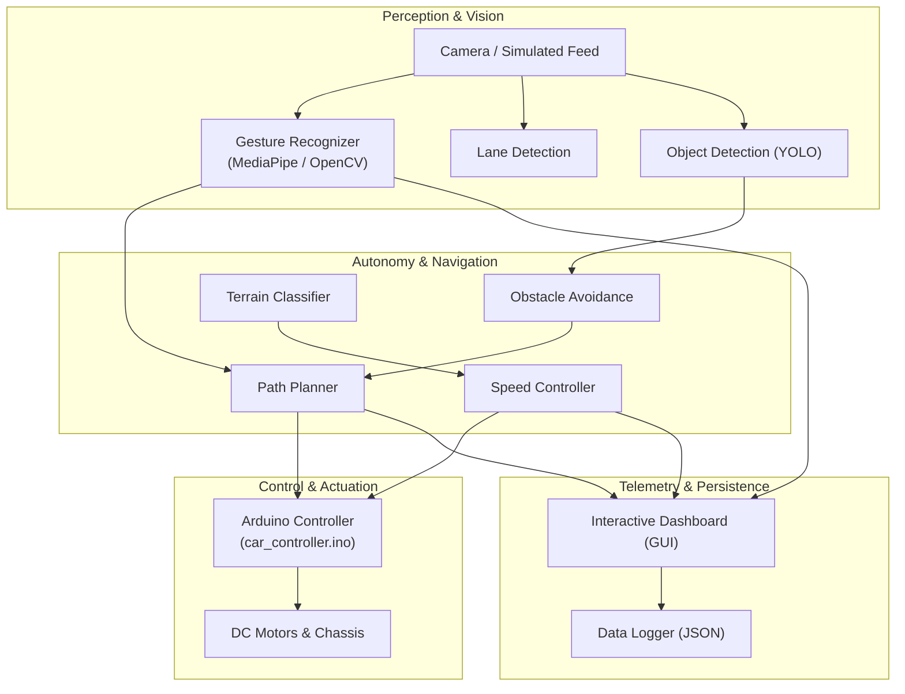

# 🚗 ASEP-2: Autonomous Gesture-Controlled Vehicle

[](https://www.python.org/downloads/)
[](https://opensource.org/licenses/MIT)
[](https://opencv.org/)
[](https://mediapipe.dev/)

An intelligent autonomous vehicular platform that combines **real-time computer vision hand-gesture recognition**, **dynamic obstacle avoidance & path planning**, **terrain-adaptive speed profiling**, and an **interactive telemetry dashboard**. Designed for both physical robotics with Arduino microcontroller integration and standalone desktop simulation.

---

## 🌟 Key Features

- **✋ Vision-Based Gesture Recognition**:
  - Dual-engine tracking using **Google MediaPipe** and **OpenCV** contour/hull defect analysis.
  - Recognizes navigation commands: `FORWARD`, `BACKWARD`, `LEFT`, `RIGHT`, and `STOP`.
  
- **🗺️ Autonomous Path Planning & Collision Avoidance**:
  - Vector-based waypoint generation with continuous obstacle detection.
  - Automatic tangential rerouting when obstacles are detected along the trajectory.

- **🏔️ Terrain Classification & Dynamic Speed Profiling**:
  - Categorizes surface conditions (`flat`, `smooth`, `rough`, `steep`).
  - Automatically modulates motor PWM, acceleration, and braking curves according to terrain difficulty.

- **📊 Real-Time Telemetry Dashboard**:
  - Tkinter & Matplotlib GUI displaying live camera feed, system states, speed, battery health, and odometer.
  - Visual timeline plotting telemetry trends dynamically at 30 FPS.

- **🤖 Arduino Hardware Bridge**:
  - Serial protocol (`car_controller.ino`) connecting Python high-level intelligence to motor drivers (L298N/PWM) and ultrasonic distance sensors.

- **🎮 Seamless Simulation Mode**:
  - Built-in synthetic camera generator and mock sensor feeds allow complete testing and development without requiring physical webcams or Arduino hardware.

- **📝 Automated Data Logging**:
  - Records vehicle states, planned trajectories, and telemetry into timestamped JSON files for playback and analytics.

---

## 🏛️ System Architecture



---

## 📁 Repository Structure

```
.
├── arduino/
│   ├── car_controller.ino    # Arduino sketch for motor driver & sensor telemetry
│   ├── communication.h       # Serial protocol definitions
│   ├── motors.h              # Motor PWM and direction control logic
│   └── sensors.h             # Ultrasonic & environmental sensor drivers
├── navigation/
│   ├── localization.py       # Odometry & dead-reckoning pose tracking
│   ├── mapping.py            # 2D grid environment occupancy mapper
│   ├── obstacle_avoidance.py # Trajectory safety verification & rerouting
│   └── path_planning.py      # Waypoint generator based on gesture vectors
├── terrain/
│   ├── speed_controller.py   # Terrain-specific acceleration/deceleration profiles
│   └── terrain_classifier.py # Surface feature evaluation (roughness, slope)
├── ui/
│   ├── control_panel.py      # Manual override control window
│   └── dashboard.py          # Real-time telemetry GUI with live video feed
├── utils/
│   ├── communication.py      # Python PySerial bridge to Arduino
│   ├── config.py             # Configuration loader with dot-notation access
│   ├── data_logger.py        # Structured JSON run logger
│   └── visualization.py      # OpenCV multi-camera dashboard drawer
├── vision/
│   ├── camera_utils.py       # Camera capture handler with virtual road generator
│   ├── gesture_recognition.py# MediaPipe & OpenCV hand gesture classifier
│   ├── lane_detection.py     # Canny & Hough transform lane line detector
│   └── object_detection.py   # YOLO-based obstacle & object detector
├── config.json               # System configuration parameters
├── main.py                   # Main control loop & application entrypoint
└── requirements.txt          # Python dependencies
```

---

## 🚀 Quick Start

### 1. Clone the Repository
```bash
git clone https://github.com/your-username/autonomous-gesture-controlled-vehicle.git
cd autonomous-gesture-controlled-vehicle
```

### 2. Install Dependencies
Ensure you have Python 3.8+ installed:
```bash
pip install -r requirements.txt
```

### 3. Run the System
Launch the main application:
```bash
python main.py
```
*Note: If no physical webcam or Arduino is detected, the vehicle automatically initializes in **Simulation Mode** with a virtual road and synthetic camera feed.*

---

## ⚙️ Configuration (`config.json`)

You can customize camera parameters, speed profiles, thresholds, and simulation modes directly in `config.json`:

```json
{
  "system": {
    "name": "ASEP-2 Autonomous Vehicle",
    "simulation_mode": true
  },
  "arduino": {
    "port": "COM3",
    "baud_rate": 9600,
    "enabled": false
  },
  "camera": {
    "device_id": 0,
    "width": 640,
    "height": 480,
    "mock_fallback": true
  }
}
```

---

## 🔌 Arduino Hardware Setup

If connecting to a physical RC car chassis:
1. Open [arduino/car_controller.ino](file:///c:/Users/patil/OneDrive/Documents/Autonomous%20Gesture-Controlled%20Vehicle/arduino/car_controller.ino) in the Arduino IDE.
2. Select your board (e.g., Arduino Uno / Mega / Nano) and upload the sketch.
3. Wire the motor driver (e.g., L298N) and ultrasonic sensor pins as defined in [motors.h](file:///c:/Users/patil/OneDrive/Documents/Autonomous%20Gesture-Controlled%20Vehicle/arduino/motors.h) and [sensors.h](file:///c:/Users/patil/OneDrive/Documents/Autonomous%20Gesture-Controlled%20Vehicle/arduino/sensors.h).
4. Set `"enabled": true` and verify your COM port in `config.json`.

---

## 📄 License

This project is licensed under the MIT License - see the LICENSE file for details.

